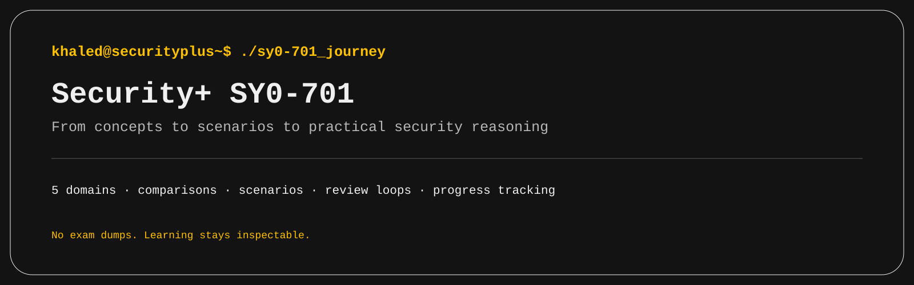
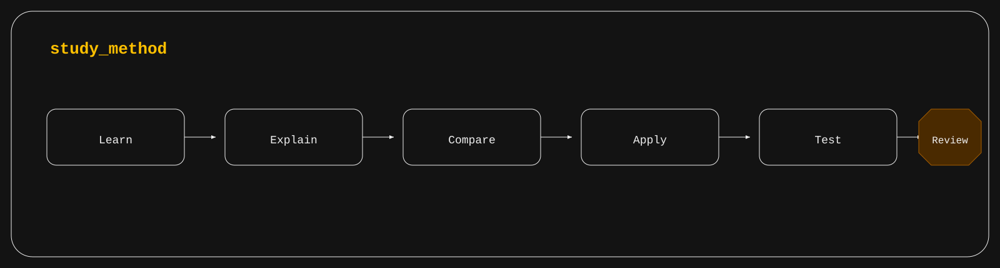
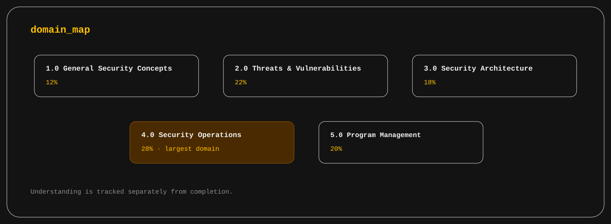
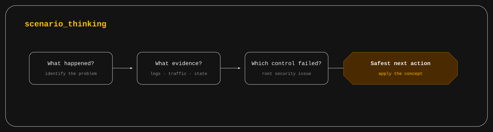

<div align="center">



</div>

---

## What this repository is

This repository documents my preparation journey for **CompTIA Security+ SY0-701**.

It is not an exam-dump repository and it is not intended to reproduce proprietary exam questions.

The goal is to turn the syllabus into something inspectable:

```text
Objective
   ↓
Understand the concept
   ↓
Compare it with related concepts
   ↓
Apply it to a scenario
   ↓
Connect it to a practical security task
   ↓
Review and validate understanding
```

The repository is designed as a study system rather than a pile of notes.

---

## Study philosophy

Security+ covers a wide range of cybersecurity topics.

Instead of memorizing isolated definitions, this repository focuses on three questions:

1. **What does this concept mean?**
2. **How is it different from similar concepts?**
3. **What would it look like in a real environment?**

That structure helps turn exam preparation into reusable cybersecurity knowledge.

<div align="center">



</div>

---

# Domains

The repository follows the five SY0-701 domains.

| Domain | Weight | Focus |
|---|---:|---|
| **1.0 General Security Concepts** | 12% | Security principles, controls, cryptography, PKI |
| **2.0 Threats, Vulnerabilities & Mitigations** | 22% | Threat actors, vulnerabilities, attack techniques, mitigation |
| **3.0 Security Architecture** | 18% | Architecture, cloud, resilience, secure infrastructure |
| **4.0 Security Operations** | 28% | Monitoring, vulnerability management, IAM, IR, forensics |
| **5.0 Security Program Management & Oversight** | 20% | Governance, risk, compliance, policy, awareness |

<div align="center">



</div>

---

# Repository Structure

```text
.
├── README.md
├── SECURITY.md
│
├── assets/
│   ├── banner.svg
│   ├── study-method.svg
│   ├── domain-map.svg
│   └── scenario-thinking.svg
│
├── progress/
│   ├── study-roadmap.md
│   └── objective-tracker.md
│
├── domains/
│   ├── 01-general-security-concepts.md
│   ├── 02-threats-vulnerabilities-mitigations.md
│   ├── 03-security-architecture.md
│   ├── 04-security-operations.md
│   └── 05-security-program-management.md
│
├── comparisons/
│   ├── authentication-vs-authorization.md
│   ├── iam-vs-pam.md
│   ├── ids-vs-ips.md
│   ├── stateful-vs-stateless.md
│   ├── hashing-vs-encryption.md
│   └── preventive-detective-corrective.md
│
├── scenarios/
│   ├── incident-investigation.md
│   ├── firewall-troubleshooting.md
│   ├── access-control.md
│   └── vulnerability-management.md
│
└── review/
    ├── mistakes-log.md
    └── quick-recall.md
```

---

# Progress

Progress is tracked separately from notes.

[Study roadmap →](progress/study-roadmap.md)  
[Objective tracker →](progress/objective-tracker.md)

The tracker is intentionally transparent.

A topic is not treated as “done” because I read it once.

The states are:

```text
Not Started
    ↓
Learning
    ↓
Can Explain
    ↓
Can Apply
    ↓
Review
```

---

# Domain Notes

## 1.0 · [General Security Concepts](domains/01-general-security-concepts.md)

Focus areas include:

- CIA triad;
- security controls;
- zero trust;
- cryptography;
- hashing;
- digital signatures;
- certificates and PKI;
- authentication concepts.

---

## 2.0 · [Threats, Vulnerabilities & Mitigations](domains/02-threats-vulnerabilities-mitigations.md)

Focus areas include:

- threat actors;
- attack vectors;
- social engineering;
- malware;
- application vulnerabilities;
- network attacks;
- vulnerability assessment;
- mitigation strategies.

---

## 3.0 · [Security Architecture](domains/03-security-architecture.md)

Focus areas include:

- network architecture;
- segmentation;
- cloud;
- virtualization;
- containers;
- resilience;
- secure communication;
- enterprise infrastructure.

---

## 4.0 · [Security Operations](domains/04-security-operations.md)

Focus areas include:

- vulnerability management;
- monitoring;
- endpoint security;
- IAM;
- incident response;
- digital forensics;
- security tooling;
- operational security controls.

---

## 5.0 · [Security Program Management & Oversight](domains/05-security-program-management.md)

Focus areas include:

- governance;
- policy;
- risk management;
- third-party risk;
- compliance;
- audits;
- awareness;
- security metrics.

---

# Comparisons

A large part of Security+ is recognizing the difference between concepts that sound similar.

Examples:

- [Authentication vs Authorization](comparisons/authentication-vs-authorization.md)
- [IAM vs PAM](comparisons/iam-vs-pam.md)
- [IDS vs IPS](comparisons/ids-vs-ips.md)
- [Stateful vs Stateless](comparisons/stateful-vs-stateless.md)
- [Hashing vs Encryption](comparisons/hashing-vs-encryption.md)
- [Preventive vs Detective vs Corrective](comparisons/preventive-detective-corrective.md)

These notes are written to answer:

> **What is the difference, why does it matter, and what does it look like in practice?**

---

# Scenario Thinking

<div align="center">



</div>

I use scenarios to test whether a concept is actually understood.

Examples:

- A firewall rule exists but the application is still unreachable.
- A valid user can perform an administrative action they should not be allowed to perform.
- A SIEM alert shows suspicious authentication activity.
- A vulnerability cannot be remediated within the required SLA.

The useful response is not only naming a technology.

It is understanding:

```text
What happened?
What evidence would I check?
Which control failed?
What is the safest next action?
```

[Scenario notes →](scenarios/)

---

# Mistakes Log

One of the most useful parts of studying is documenting **why an answer was wrong**.

[Open mistakes log →](review/mistakes-log.md)

The log tracks:

```text
Question / concept
      ↓
Why my reasoning failed
      ↓
Correct principle
      ↓
How to recognize it next time
```

---

# Quick Recall

[Quick recall sheet →](review/quick-recall.md)

This is reserved for short, high-value distinctions and memory triggers.

Examples:

```text
Authentication = Who are you?
Authorization  = What are you allowed to do?

Hashing    = one-way integrity / comparison
Encryption = reversible confidentiality

Preventive = stop
Detective  = discover
Corrective = restore / fix
```

---

# What this project demonstrates

This repository is designed to show:

`Structured Learning` ·
`Security Fundamentals` ·
`Scenario Reasoning` ·
`Technical Comparisons` ·
`Security Architecture` ·
`Security Operations` ·
`GRC` ·
`Continuous Review`

The objective is not to prove knowledge by saying:

> “I studied Security+.”

It is to make the learning process visible enough that another person can inspect how the concepts were understood.

---

## Exam integrity

This repository contains original study notes and practice reasoning.

It does not contain:

- leaked exam questions;
- proprietary exam dumps;
- memorized real-exam answer sets.

---

<div align="center">

### Khaled AlKailani

**CompTIA Security+ SY0-701 Study Journey**

<sub>Concepts → scenarios → practical security reasoning.</sub>

</div>
